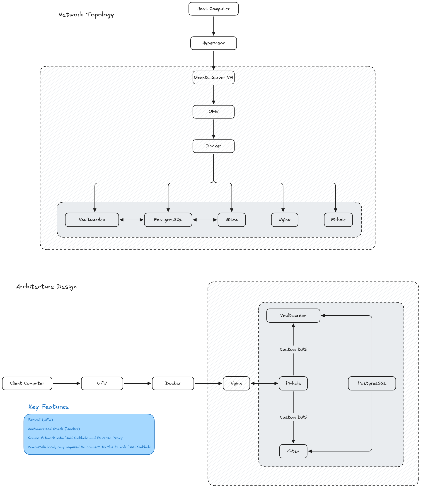

# Mission 10: The Enterprise Cloud Architect

## Project Overview

This project is the final mission for CCM101 -- Cloud Computing. It
demonstrates the design, deployment, security, automation, and
documentation of a multi-tier application hosted on an Ubuntu Server
virtual machine.

The application uses Docker and Docker Compose to run connected
services. Persistent storage is configured for the database so that
application data remains available after a VM restart. Host-based
security is managed through UFW, while a scheduled Bash script automates
an operational task such as database backups or system health checks.

## Objectives

-   Design and document the cloud infrastructure and network topology.
-   Provision an Ubuntu Server virtual machine.
-   Install and configure Docker and Docker Compose.
-   Deploy a multi-tier application with at least two linked containers.
-   Configure persistent database storage.
-   Secure the server using UFW with a default-deny policy.
-   Allow only the ports required by the application and SSH
    administration.
-   Create an executable Bash automation script.
-   Schedule the script using Cron.
-   Document deployment, security, and maintenance procedures.

## Technology Stack

Update this table to match the services actually used in your
deployment.

  Component                 Technology / Configuration
  ------------------------- ------------------------------------------
  Host machine              \[Windows / Linux / macOS\]
  Hypervisor                \[VirtualBox / VMware / other\]
  Virtual machine OS        Ubuntu Server \[version\]
  Container platform        Docker
  Container orchestration   Docker Compose
  Application               \[WordPress / Nextcloud / other\]
  Database                  \[MySQL / MariaDB / PostgreSQL / other\]
  Persistent storage        Docker named volume: \[volume name\]
  Firewall                  UFW
  Automation                Bash script and Cron
  Access method             Web browser and SSH

## Architecture

Add your completed architecture diagram as `architecture-diagram.png`.

The diagram should show the relationship between:

1.  Host computer
2.  Type 2 hypervisor
3.  Ubuntu Server virtual machine
4.  UFW firewall
5.  Docker and Docker Compose
6.  Application container
7.  Database container
8.  Persistent database volume
9.  Client web browser / host access



## Repository Contents

``` text
Laboratory-10-Enterprise-Cloud-Architect/
├── README.md
├── architecture-diagram.png
├── docker-compose.yml
├── automation-script.sh
├── operational-manual.md
└── final-reflection.md
```

## Deployment Summary

The application is deployed on the Ubuntu Server VM using Docker
Compose.

From the directory containing `docker-compose.yml`, the usual deployment
commands are:

``` bash
docker compose up -d
docker compose ps
docker compose logs
```

To stop the application:

``` bash
docker compose down
```

> Review these commands and the service names in your actual Compose
> file before using them. Do not use `docker compose down -v` unless you
> intentionally want to remove the named volumes and their stored data.

## Security

The server uses UFW to restrict incoming network traffic. The intended
policy is to deny incoming connections by default and allow only the
ports required for remote administration and application access.

Example commands (adjust the ports to match your actual deployment):

``` bash
sudo ufw default deny incoming
sudo ufw default allow outgoing
sudo ufw allow OpenSSH
sudo ufw allow [APPLICATION_PORT]/tcp
sudo ufw enable
sudo ufw status verbose
```

Replace `[APPLICATION_PORT]` with the actual application port before
running the command. Do not expose database ports publicly unless there
is a documented requirement.

## Automation

The `automation-script.sh` file contains the project's operational
automation task.

-   **Task performed:** \[Describe the backup, health check, or log
    maintenance task.\]
-   **Schedule:** \[Describe the Cron schedule.\]
-   **Output / backup location:** \[Specify the location.\]
-   **Verification:** \[Explain how you confirmed that the script ran
    successfully.\]

Make the script executable:

``` bash
chmod +x automation-script.sh
```

Edit the user's Cron table:

``` bash
crontab -e
```

Add the actual schedule and absolute script path, for example:

``` cron
[MINUTE] [HOUR] * * * /absolute/path/to/automation-script.sh
```

Replace the placeholders with the schedule and path used in your
environment.

## Documentation

See [Operational Manual](operational-manual.md) for the detailed
installation, deployment, firewall, automation, backup, recovery, and
maintenance procedures.

See [Final Reflection](final-reflection.md) for a reflection on the
learning experience from Mission 1 through Mission 10.

## Testing and Verification

Record the results of your own tests below.

-   [ ] Ubuntu Server starts successfully.
-   [ ] The host computer can reach the VM.
-   [ ] Docker and Docker Compose are installed and working.
-   [ ] Both application and database containers start successfully.
-   [ ] The application can communicate with the database.
-   [ ] Database data remains after a VM restart.
-   [ ] UFW is enabled with the intended default-deny policy.
-   [ ] Only required inbound ports are allowed.
-   [ ] The Bash script runs successfully when executed manually.
-   [ ] Cron is configured and the scheduled task has been verified.
-   [ ] The architecture diagram and operational manual are included.

## Troubleshooting Notes

Document problems encountered during deployment and the solutions you
tested.

  Issue                Cause                Solution
  -------------------- -------------------- -----------------------
  \[Describe issue\]   \[Describe cause\]   \[Describe solution\]
  \[Describe issue\]   \[Describe cause\]   \[Describe solution\]

## Acknowledgment

This project was completed as part of the CCM101 -- Cloud Computing
laboratory activities. All configuration details, test results, and
screenshots should reflect the actual implementation.

------------------------------------------------------------------------

**Important:** Replace all bracketed placeholders and remove any
statements that do not match your deployed system before submitting.

